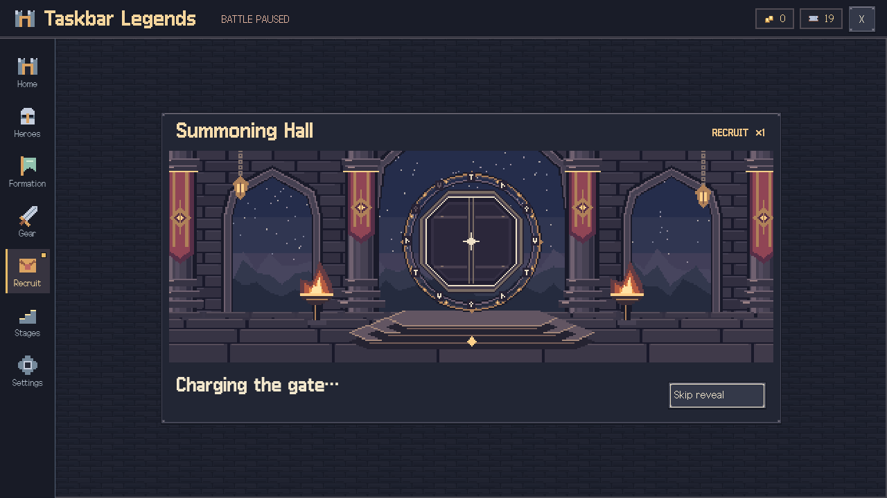
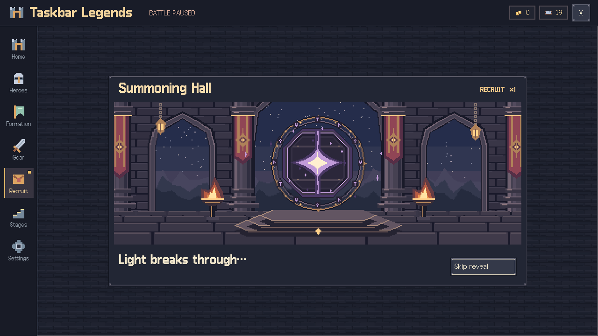
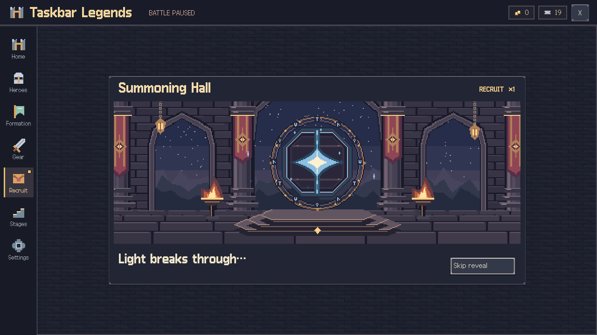
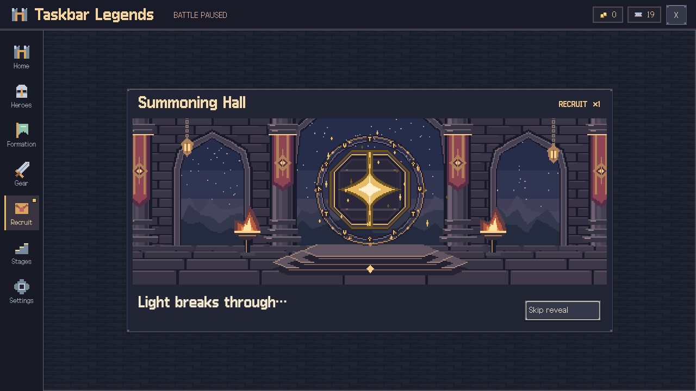
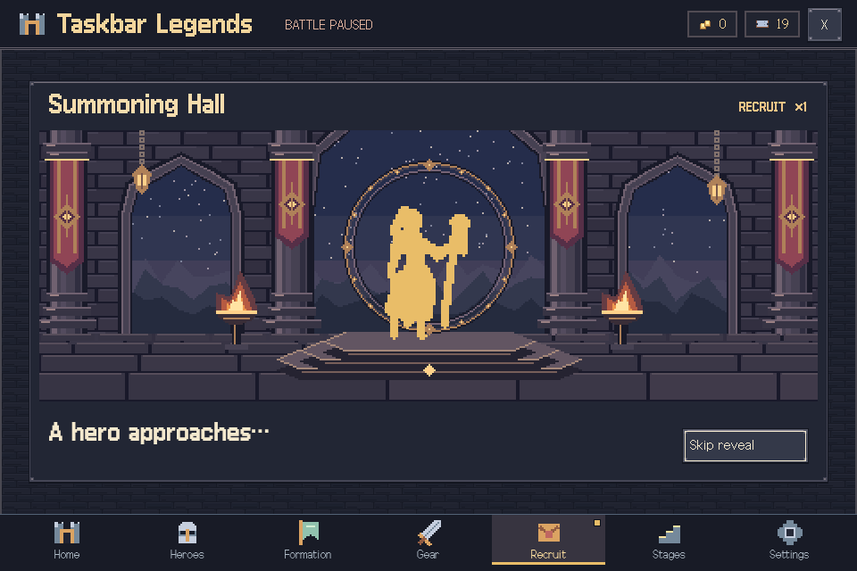
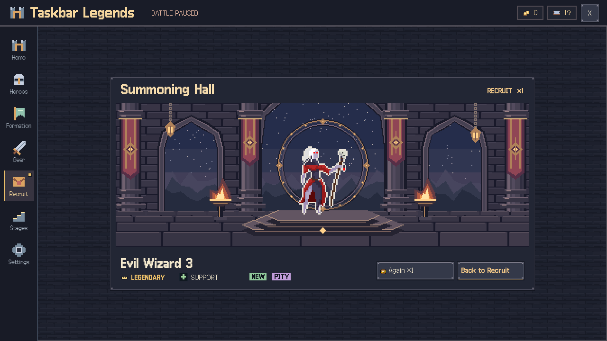
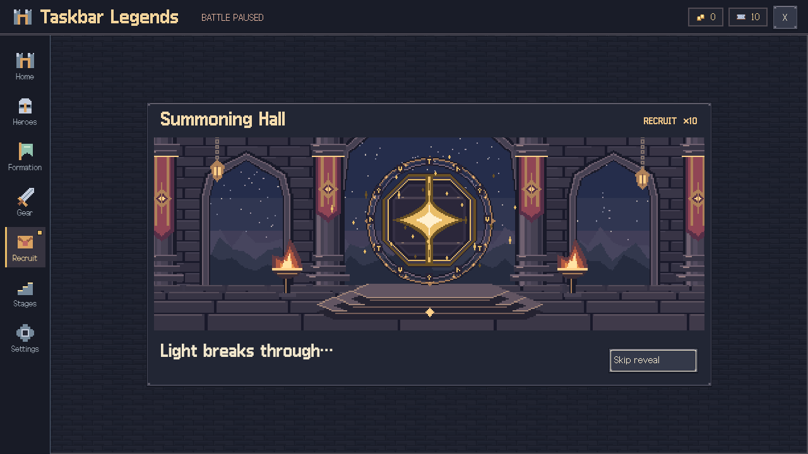
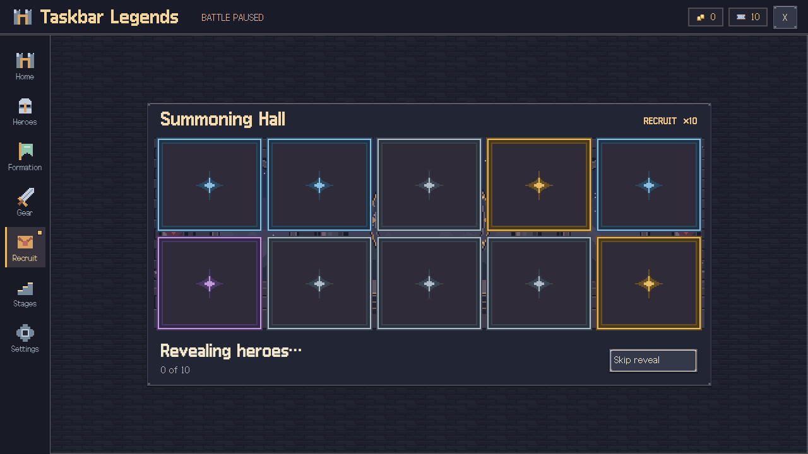
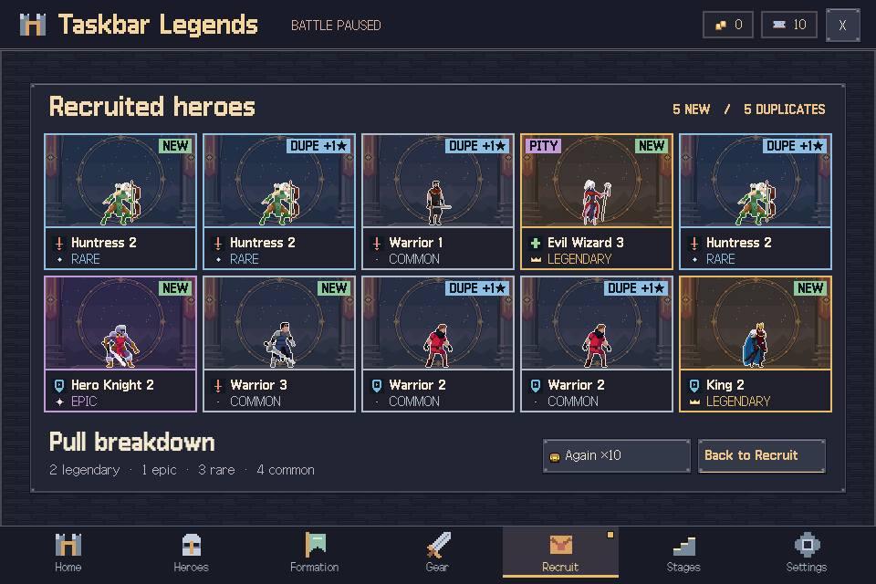

# A pull in the Summoning Hall

Open **Menu → Recruit** from the strip. One ticket opens the gate for one hero. Ten tickets bring out ten heroes together.

## Watch the light

The camera moves closer as twelve runes light up around the doors. Every pull starts with the same warm light. After a second and a half, the light through the seam takes the color of the best hero. Dim grey-white means common, blue means rare, purple means epic and gold means legendary.

Sometimes the color upgrades. These next two frames come from the same legendary pull, 0.68 seconds apart.

The doors part around the hero’s silhouette. Epic and legendary heroes linger before the burst. This pull shows Evil Wizard 3 and his pity badge at 5.96 seconds.

## Follow the ten cards

Gold at the gate means at least one legendary. Once the cards land, their rims give another clue. Here the fourth and tenth cards have gold edges. Cards flip from left to right across each row, pausing before each epic and legendary. The summary appears at 9.92 seconds with five new heroes and five duplicates.

Tap the stage or choose **Skip reveal** at any beat. **Settings → Reduced motion** and the system motion preference show the same results immediately. **Again** spends tickets on another pull. **Back to Recruit** closes the result.

Start the dev server with `npm run dev`. Run `node scripts/gacha-flow-shots.mjs after` to replay the examples at 1280×720 and 960×640.
