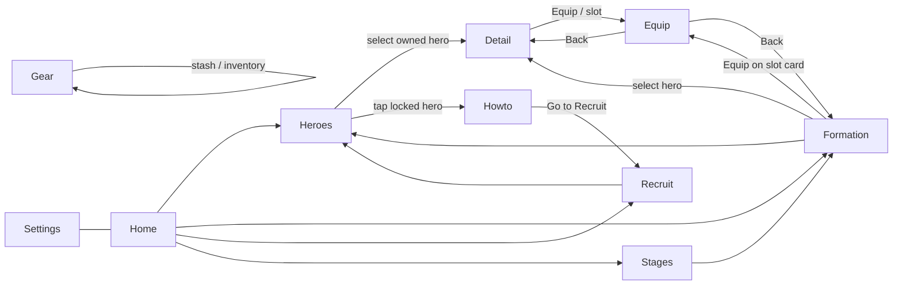

# Management-window prototype — layout spec

Prototype only. Do not treat this as a runtime change. Tokens below are **proposals**; `ui/runtime/ui-tokens.json` was not edited.

Identity that stays: TBH outlined idle-0 sprites, Galmuri11 at 12 / 24 and Galmuri9 at 10, panel and button 9-slices, the ui-tokens palette, rarity colours and shapes. The taskbar lane stays 640 × 160. Only the management window changes.

## 1. Window sizes

| Role | Size | Why |
|---|---|---|
| Primary preset | **1280 × 720** | 16:9. Fits a 6-column roster of 18, a 5× (~260 px) hero portrait, three skill cards, and a 3-slot equipment column without scrolling. Left 80 px icon rail. |
| Mid preset | **960 × 640** | 3:2. Same screens, bottom 64 px nav, 5-column roster, 2× portrait on detail, equipment under the portrait. Tight but no typography or hit-target shrink. |
| Minimum | **960 × 600** | Below this, letterbox rather than scale fractionally. Do not shrink Galmuri below 12 / 24 / 10 or hit targets below 32 px. |
| Resize | Allowed | Integer zoom (1× / 2×) plus letterbox. No fractional scale. |

The current sheet (624 × 400 at W=640, 720 × 400 at W≥736, open window 640 × 568, native 760 × 560) cannot hold a roster grid, a large integer portrait, skill cards, and 40–48 px targets at once. At 960 and 1280 today the sheet stays 720 × 400, left-aligned under a 640-wide lane, with leftover empty page — see `before/` and `compare/`.

## 2. Layout grid

8 px base. All positions and sizes are integers.

| Token (proposed) | 1280 × 720 | 960 × 640 |
|---|---|---|
| `window.topbarHeight` | 56 | 56 |
| `window.navRailWidth` | 80 (left) | — |
| `window.navBottomHeight` | — | 64 |
| `window.gutter` | 16 | 16 |
| `window.safe` | 16 inset from the 9-slice | 16 |
| Content box | 1200 × 664 | 960 × 520 |

Columns inside content: 1280 uses a 12-column 16 px-gutter flex/grid (e.g. detail 260 / 1fr / 280). 960 uses 8 columns, stacking the third pane under the first (equipment under the portrait).

## 3. Navigation

Primary destinations are tabs in the rail (1280) or bottom nav (960): **Home, Heroes, Formation, Gear, Recruit, Stages, Settings**.

Hero detail is a **push** from Heroes, Home party busts, or Formation, not a tab. Back returns to Heroes.



Esc / the 40 × 40 X closes the management window (lane stays).

## 4. Hit targets and type

| Role | Size |
|---|---|
| Primary action (Recruit ×1 / ×10, Push, Open Stages) | 48 px tall (`btn.lg`) |
| Default button, nav item, gear cell, toggle row | 40 px (nav 48–64) |
| Absolute minimum | 32 px (dropdown options, compact 960 rows) |

Type: Galmuri11 12 regular / 24 bold for titles, Galmuri9 10 for meta, badges, and nav labels. No native `<select>`, `<input type="range">`, or system widgets.

Sprites: `image-rendering: pixelated`, integer scale only, idle frame 0 of the outlined sheet, cropped to opaque ink.

## 5. Components (with sizes)

| Component | Size / notes |
|---|---|
| Top bar | 56 px. Title 24 px gold, wallet (gold + tickets), 40 × 40 close. |
| Nav button | 64 × 64 in the rail (icon 16 px at 2× = 32, Galmuri9 label). 48+ tall in the bottom bar, equal width. |
| Hero card | Art well 128 × 128, shared 2× integer scale, bottom-anchored, nearest-neighbour. Stars, shortName (never ellipsized; fall back to Galmuri9 10 px if 12 px does not fit), combat-role badge, level. Rarity 2 px frame. Catalog role and family stay off the card. Locked silhouettes use the same 2× scale; tapping one opens the how-to-get panel. |
| Roster grid | 6 columns at 1280 (18 fit on one screen). 5 columns at 960 (scroll for the locked tail). Sort and filter: combat role, rarity, name, level. No Turn SPD sort. |
| Detail portrait | 1280: 4× in a ~220 × 260 well with a rarity-tinted backdrop. 960: 2×. Title is shortName; full catalog name sits underneath as a Galmuri9 10 px subtitle. Combat role + rarity badges, then catalog role · family. |
| Skill card | Icon well 48 × 48, name, kind (Basic / Signature + mana cost / Passive), description, and a Galmuri9 10 px meta line “Scales with level and stars”. No skill level and no upgrade button. Real mana: default 60; mh2 40; wiz, mw3, ew2, mk2, mh3 80. Basics grant 20 mana; tanks gain 5 on direct hostile HP damage. |
| Equipment slots | Three independent slots only — weapon, armor, charm — in a column (1280) or under the portrait (960). 64 px tall (40 px min at 960). No set-bonus area. |
| Formation slots | FRONT, MIDDLE, REAR. Party size stays 3. No fourth slot. Art well 112 × 112 (1280) / 96 × 96 (960). Click slot, then bench hero to swap. shortName on the slot and bench. |
| Gear cell | 48 × 48, icon at 2× (32 px), rarity inset rim, lock mark. Inventory cap 50, lock max 30. |
| Pity meters | Each meter is gated on its rule flag. v14 rules are on by default since config 1.4.2 (main is at 1.4.5), so a normal build shows Epic+ every 30 (always live), Legend every 60 and New hero every 20 on Recruit, and Fortune n/100 on Gear. When the roster is complete, the recruit meters read “Roster complete”. |
| Stage node | ≥ 52 × 52, 10 nodes per chapter, 5 per row, boss at node 10 (x-10) with a red rim. Cleared green, current gold. A chapter tab rail sits above the grid (Ch 1 and Ch 2 now; the rail grows when later chapters exist). No difficulty switch and no world map. |
| Settings | Pause and mute toggles (48 × 24), four volume sliders (master, music, SFX, UI), zoom 1× / 2×, placement Free / Snap to bottom, Reset size, Recovery help, offline summary. |
| How-to-get panel | 280 px card: locked silhouette in its rarity frame, shortName, catalog role, signature name and kind (no description), “Base odds per pull” (rarity rate ÷ catalog heroes of that rarity, always two decimals: common 8.33%, rare 6.60%, epic 3.25%, legendary 1.33%), a Galmuri9 10 px muted line “Pity raises this”, and a 48 px “Go to Recruit” button. Odds are uniform within each rarity; owned heroes stay in the pool. |
| Home campaign | Current stage id and state (Pushing / Farming / Boss ready / Boss fight). When BOSS_READY, a 48 px primary “Fight boss” button. |

| Equip screen | Centre stage: a large integer-scaled sprite on a rarity-tinted pixel ring/plate (5× typical at 1280, 3× typical at 960, per-hero `scaleFit`), shortName + Galmuri9 full-name subtitle and combat-role badge under the sprite, 48 px prev/next arrows on either side of the hero (arrow keys too; roster order). Three rarity-framed slot cards (≥ 64 px) around the ring — weapon left, armor right, charm top — joined by faint pixel lines to the plate ticks; each card shows the item icon at 2×, level, and a short stat line. Empty slots use a dashed outline and a “+”. The selected slot has a gold highlight. A compact HP / ATK / DEF / Turn SPD summary sits under the name. Tapping a slot opens a drawer (right side at 1280; bottom sheet, at most the lower part, two columns at 960) so the hero and all three slots stay visible. The list is that slot only, best-first by `gearScore` from economy.ts (`hp×0.2 + atk×4 + def×2 + secondary%×100`; prototype items store already-scaled display stats, so the official `× (1 + 0.1×level)` term is already in the roll). Each row: rarity frame and shape cue (dot / diamond / 4-point star / crown), level, lock icon, and “Worn by {shortName}” when another hero wears it. Compare panel: current vs new for HP, ATK, DEF, and Turn SPD (charm-% form, e.g. `90 → 97 +8%`), one stat per line at 12/16, green better / red worse / muted unchanged. Equip (reads Swap when stolen from another hero, with a note that that hero loses it), Unequip, Upgrade (real `upgradeCost`: `round(90 × 1.06^(dropStage−1) × rarityMult × (level+1)^1.4)`), Lock/Unlock, and optional Auto-equip best. Primary 48 px gold, secondary 40 px outline. Opened from hero detail (slot or Equip) and Formation (Equip on each slot card). Gear remains the stash / inventory screen. |
## 5a. Equip screen

A push, not a tab. Entry: hero detail (tapping a gear slot, or the Equip button) and Formation (an Equip button on each FRONT / MIDDLE / REAR card). Back returns to the screen that opened it. Gear stays the stash and inventory screen; detail slots no longer jump to Gear.

The hero stands in the **centre**, on a rarity-tinted pixel ring/plate, with the three slots around them (Summoners War rune ring / Dislyte relic layout). Weapon sits on the left, armor on the right, charm on top, each joined to a gold tick on the ring by a faint pixel line. 48 px prev/next arrows flank the hero and cycle owned heroes in roster order (arrow keys too). shortName, a Galmuri9 full-name subtitle, and the combat-role badge sit under the sprite; a compact HP / ATK / DEF / Turn SPD summary sits under that (Turn SPD uses the same charm-% form as detail).

Slot cards are large rarity-framed tiles, at least 64 px, with the item icon at 2×, its level, and a short stat line. Empty slots show a dashed outline and a “+”. The selected slot gets a gold highlight.

**1280 × 720** — the ring is a 320 px plate (2× the 160 px art) and the hero typically scales at 5× (per-hero integer `scaleFit` against a 220 × 268 box). Tapping a slot opens a **right-side drawer** with the slot list above and a fixed compare + actions panel below. List rows are the same 48 px tiles as the 960 sheet (6 px padding; title on the first line; stats and “Worn by {shortName}” on the second, clear of the rarity frame). The list scrolls inside its own area; a thin scrollbar in the token colours (ink track, edge thumb) and, when more items remain, a short panel-coloured fade with a pixel down-caret in the gap above the compare panel. The hero and ring stay visible; the stage is centred in the remaining column. Screenshots are 1× (`deviceScaleFactor` 1); there is no @2× set.

**960 × 640** — the plate is 160 px (1×) and the hero typically scales at 3×. The drawer becomes a **bottom sheet** covering no more than the lower part of the window (list and compare side by side). The hero and all three slots stay visible with the compare panel open. Nothing clips, and names are never ellipsized (Galmuri9 10 px fallback).

**Scoring and cost** are taken from `e64bb32` `src/core/economy.ts`. Auto-equip best puts the highest-`gearScore` item of each slot onto the current hero (a worn item is swapped off its previous owner).

## 6. Information architecture (from game code)

Only fields that exist at `e64bb32` are shown as live. Anything extra is marked **proposed**.

**Hero:** id, name, shortName (strip leading “Medieval ”; “Martial Hero” → “Martial”; keep numeric suffixes). shortName is used on every compact surface (roster cards, formation slots, Home busts, recruit ×1/×10 result cards, recruit history rows, toasts). The full catalog name appears only on hero detail, as a Galmuri9 10 px subtitle under the shortName title, and in hover tooltips (`title`). Names are never ellipsized; if a name does not fit at Galmuri11 12 px, it falls back to Galmuri9 10 px. Catalog role (tank / warrior / ranger / mage / support) and family appear on detail only. Combat role (tank / dps / support) goes on every card. There is no element / affinity field and no element slot. Also: tags, rarity (common / rare / epic / legendary), starter flag, stat mods, level (1–50), stars (1–6), XP (to next = round(4000 × L^1.3)), lock, owned.

**Stats (formula in design-config):** HP, ATK, DEF from `roleBase × rarityMult × heroMod × (1 + 0.1×(L−1)) × (1 + 0.12×(stars−1)) + gearFlat`, then `× (1 + gearPct)`. Stars add +12% stats each (`perStar` 0.12). **Turn SPD** is a derived display shown on detail only, not as a sort key: support 115, tank 90, melee 100, else 105. The base value and a charm `speedPct` are shown separately, e.g. `105 +8%`.

**Skills:** Basic (name + coefficient / style), Signature (named in view.ts, mana cost, auto-cast when ready), Passive (name + rule). No skill ranks, skill level, or skill upgrade button. Cards show mana cost (where it exists), the description, and the meta line “Scales with level and stars”. Strength / weakness lines from party-definitions.

**Gear:** three independent slots — weapon (ATK), armor (HP, DEF), charm (one of atkPct / hpPct / speedPct). No set-bonus area. Rarity, level 1–10, drop stage, equipped-by, lock. Upgrade cost formula in design-config. Salvage / overflow rules exist but are not a screen here. Fortune pity (n/100) sits on Gear when the `gearFortune` rule is on.

**Formation:** 3 slots FRONT / MIDDLE / REAR. Party size stays 3; no fourth slot. No bench size beyond owned heroes.

**Recruit:** 1 ticket per pull, rates 50 / 33 / 13 / 4, uniform within rarity, Epic+ pity every 30. Duplicates give +1 star (+12% stats) up to 6, then 100 × rarity gold. Legend every 60 and New hero every 20 are shown when the `recruitPity` rule is on (on by default since 1.4.2). When the roster is complete, those recruit meters read “Roster complete”. Odds for a specific locked hero are shown as “Base odds per pull” = that rarity’s rate divided by the number of catalog heroes of that rarity, always with two decimals (common 8.33%, rare 6.60%, epic 3.25%, legendary 1.33%). Odds are uniform within each rarity, and owned heroes stay in the pool. A Galmuri9 10 px muted line under the figure reads “Pity raises this”.

**Stages:** 20 stages in two chapters, 10 nodes per chapter, 5 per row, bosses at 1-10 (22 s timer) and 2-10 (21 s). Other stages have no timer, 3 waves. First-clear tickets 1 (ch.1), 2 (2-1..2-9), 1 (2-10). A chapter tab rail above the grid shows Ch 1 and Ch 2 and can grow; no difficulty switch and no world map. Full heal between stages, HP carries between waves. Progression: PUSHING / FARMING / BOSS_READY / BOSS_FIGHT. Home shows the current stage and that state; BOSS_READY adds a 48 px “Fight boss” button. Non-boss farm is time-scaled. Boss is not auto-retried. Offline: 8 h cap, gold/h, XP/h, chest timer.

**Settings:** pause, mute, volume, music, SFX, UI, zoom 1×/2×, placement, reset size, recovery help, offline summary.

## 7. Proposed token additions

Do not write these into `ui-tokens.json` until the layout is accepted. Suggested keys:

```
window.preset1280: [1280, 720]
window.preset960:  [960, 640]
window.min:        [960, 600]
window.topbarHeight: 56
window.navRailWidth: 80
window.navBottomHeight: 64
window.gutter: 16
window.safe: 16
hit.primary: 48
hit.default: 40
hit.min: 32
roster.columns1280: 6
roster.columns960: 5
roster.artWell: [128, 128]
detail.portraitWell1280: [240, 260]
detail.portraitWell960: [112, 112]
detail.skillIcon: [48, 48]
gear.cell: [48, 48]
formation.artWell1280: [112, 112]
```

Palette, rarity, typography, and 9-slice stay as they are in `ui-tokens.json`.

## 8. Decisions

The questions below were answered by Game Designer. The prototype and this spec follow these decisions. Show only what the game has, and do not reserve space for systems we are not building.

1. **No element / affinity.** Combat role (tank / dps / support) goes on every card. Detail adds the catalog role and family. There is no element slot anywhere.
2. **No skill ranks.** Skill cards show mana cost and description, plus a Galmuri9 10 px meta line “Scales with level and stars”. No skill level and no upgrade button. Duplicates give +1 star (+12% stats).
3. **Gear stays at three independent slots** (weapon / armor / charm). No set-bonus area.
4. **Party stays at 3** (FRONT / MIDDLE / REAR). No fourth slot.
5. **Stages.** A chapter tab rail sits above the node grid, showing Ch 1 and Ch 2 now and able to grow. 10 nodes per chapter, 5 per row, boss at node 10 (x-10). No difficulty switch and no world map.
6. **Names.** shortName on every compact surface (roster cards, formation slots, Home busts, recruit ×1/×10 result cards, recruit history rows, toasts). The full catalog name appears only on hero detail, as a Galmuri9 10 px subtitle under the shortName title, and in hover tooltips. Keep numeric suffixes. Never ellipsize; if a name does not fit at Galmuri11 12 px, fall back to Galmuri9 10 px.
7. **Turn SPD** is shown on detail only, not as a sort key. Show the base value and the charm bonus separately, e.g. `105 +8%`.
8. **Home** shows the current stage and its state (pushing / farming / boss ready). When BOSS_READY, a 48 px primary “Fight boss” button. The prototype’s page-chrome toggle (Pushing / Boss ready) demonstrates that state; the default demo save is Pushing 1-7.
9. **Pity meters** are gated on their rule flags from config/rules. v14 rules are on by default since config 1.4.2 (main is at 1.4.5), so a normal build shows Legend (every 60), New hero (every 20), and Fortune (n/100 on Gear), plus the always-live Epic+ every 30. When the roster is complete, the recruit meters read “Roster complete”.
10. **Locked hero tap** opens a small how-to-get panel: silhouette and rarity frame, catalog role, signature skill name and kind as a tease (no description), “Base odds per pull” (rarity rate ÷ catalog heroes of that rarity, two decimals: common 8.33%, rare 6.60%, epic 3.25%, legendary 1.33%), a Galmuri9 10 px muted line “Pity raises this”, and a 48 px “Go to Recruit” button that navigates. Odds are uniform within each rarity; owned heroes stay in the pool.

## 9. Prototype files

Clickable prototype: `index.html` (self-contained, file:// or any static server), `style.css`, `app.js`, fonts under `fonts/`, extracted idle-0 art under `assets/`. Size and Pushing / Boss-ready toggles are page chrome, not part of the window. Current-state shots live in `before/`; new shots in `screens/` (including `home-boss-ready`, `locked-hero`, `equip`, and `equip-compare` at both sizes, plus `equip-empty-slot` at 1280); pairings in `compare/`.
